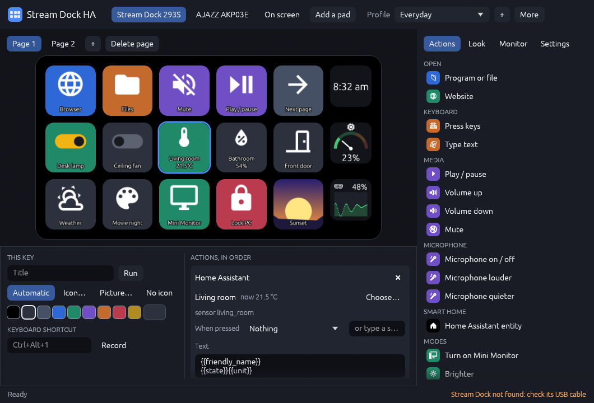
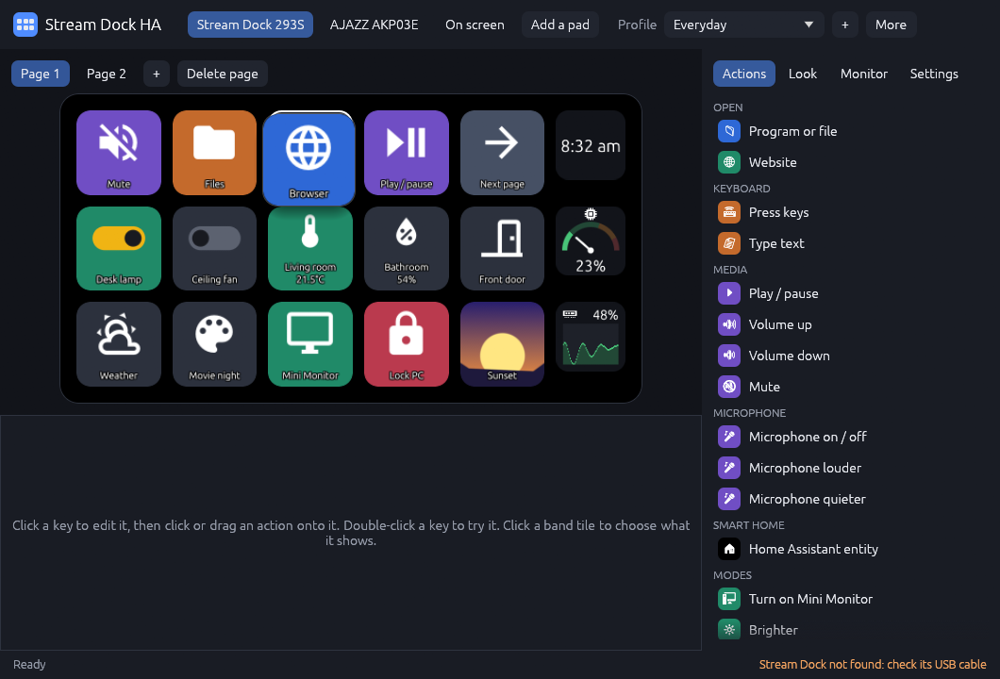
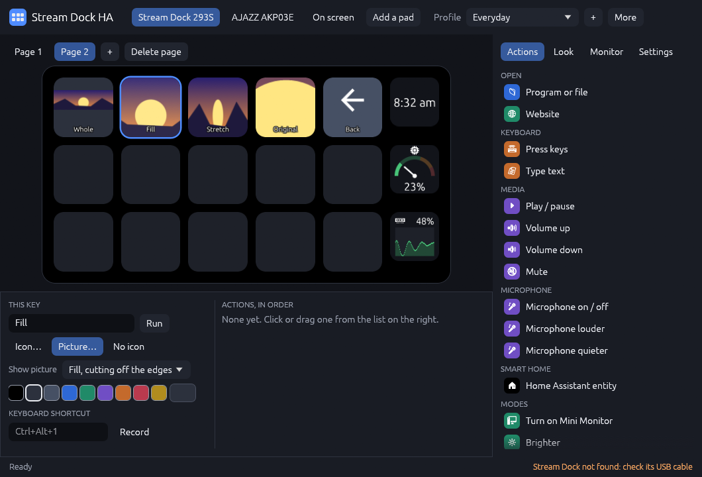
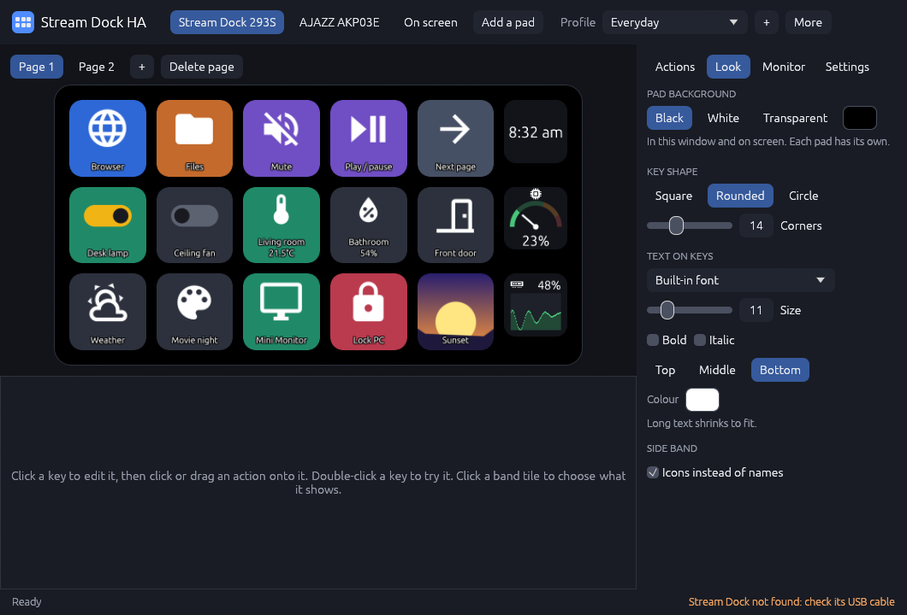
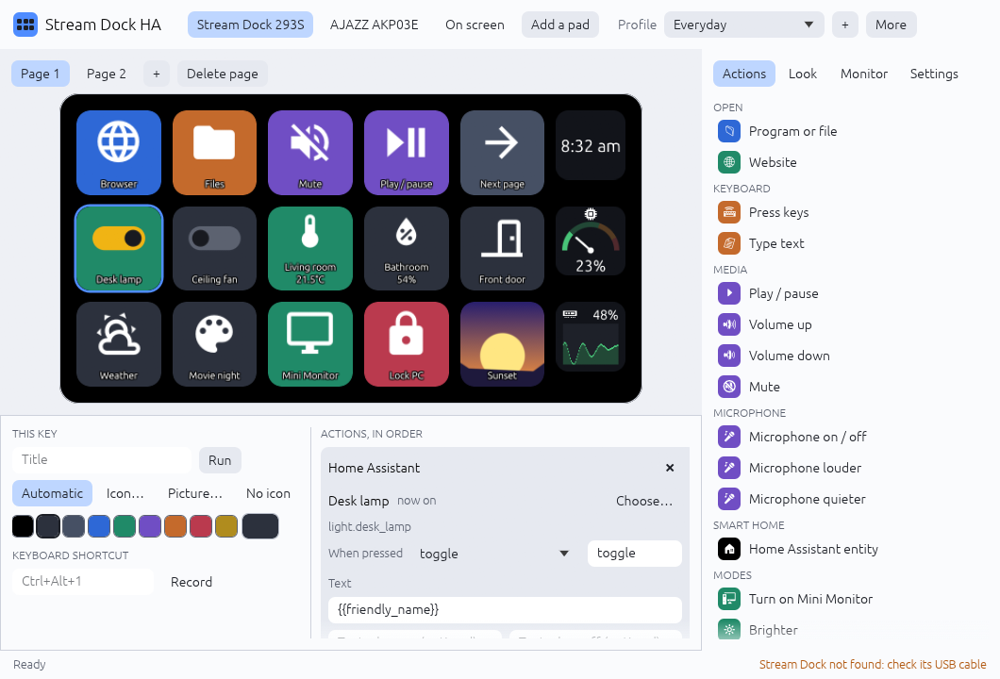
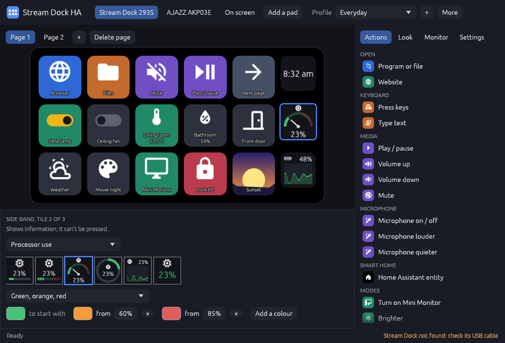
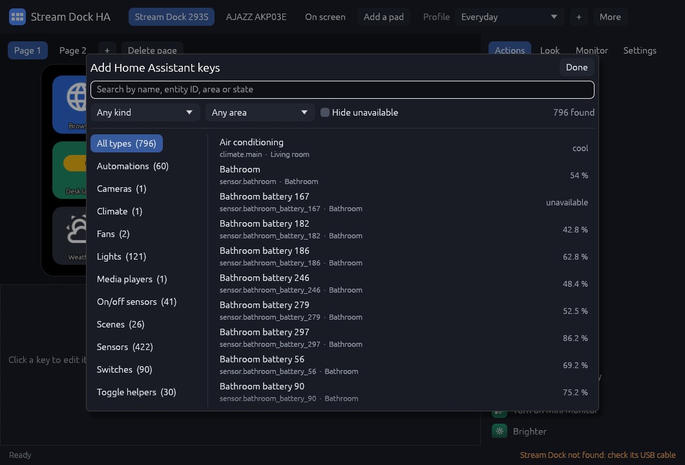
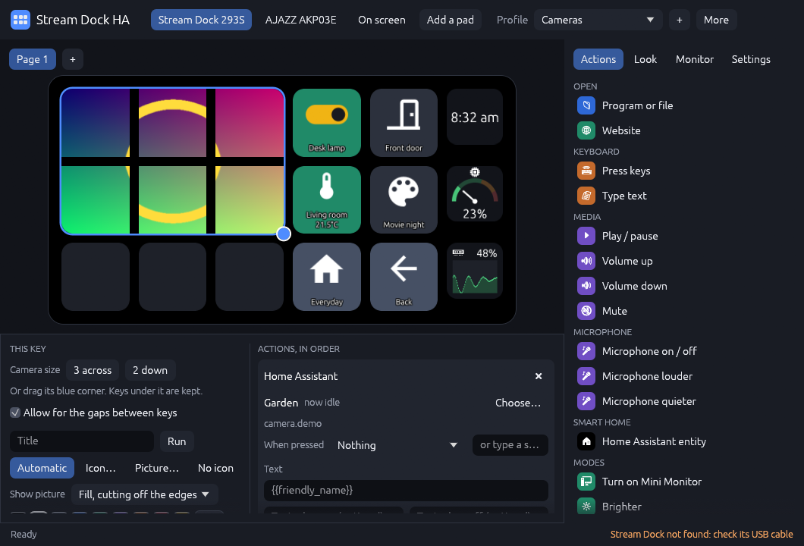
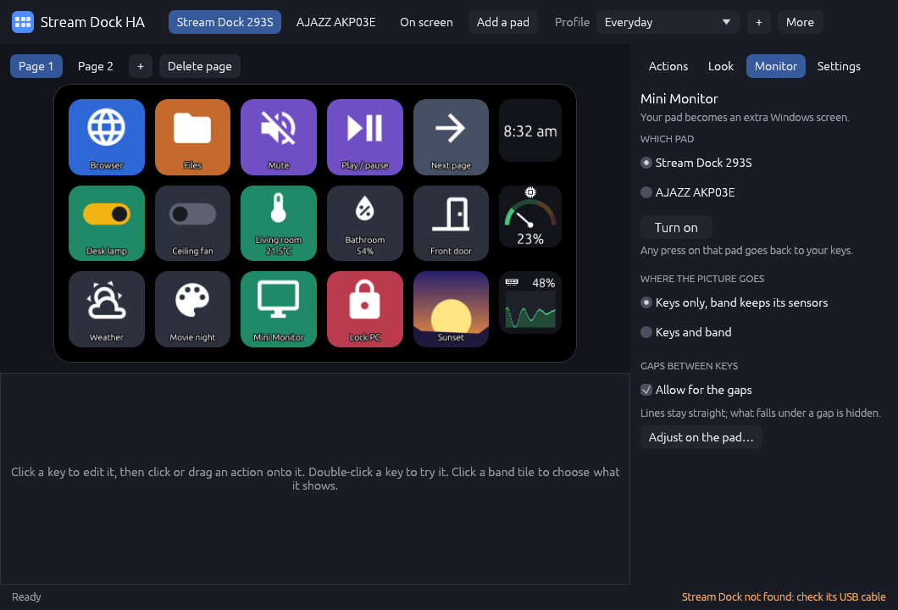
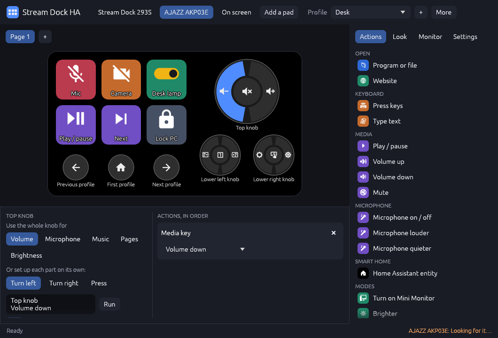

# Stream Dock HA

Stream Dock HA is a Windows desktop app that controls a **StreamDock 293S** button pad, with its 15 screen keys and the three small screens in the band on its right, and an **AJAZZ AKP03E** next to it. It's built around Home Assistant, the HA in its name, and starts quietly as an icon next to the clock, with no window unless you open one, and it replaces the StreamDock desktop app rather than running alongside it.

It is an independent rebuild, written from scratch in Rust. No code is copied from the original program, and it has no connection with the pads' manufacturers. Its sources are listed in [CREDITS.md](CREDITS.md).

Stream Dock HA was called Stream Dock Max, and before that Tray Dock, until November 2026. See [Coming from an earlier name](#coming-from-an-earlier-name) for what carries over.

## Try it

Download the setup file from the [latest release](https://github.com/Max-src/stream-dock-ha/releases/latest).

1. Close the StreamDock desktop app if it is running. Stream Dock HA leaves the pad alone while that app is open.
2. Run the file. It isn't signed, so Windows SmartScreen warns about it: choose **More info**, then **Run anyway**.
3. Choose **Install**. If **Display driver for Mini Monitor** is shown, leave it ticked to use [Mini Monitor](#mini-monitor): Windows asks for administrator rights for that step only.
4. Open Stream Dock HA from the Start Menu, or let the setup open it.

It has been tested on Windows 11. Keys appear on a StreamDock 293S as soon as it is plugged in, and on an AJAZZ AKP03E once you add it, and without a pad you can still explore the window. The program installs for your Windows user only, with no administrator rights, and you can remove it from Windows' Apps list. Everything it needs is inside it, including the C runtime; the only extra is Mini Monitor's display driver, which the setup installs for you.

### Optional: the Home Assistant integration

The app shows and controls Home Assistant entities by itself, with only an address and a token. To also see your PCs and pads **in** Home Assistant, as devices with entities, actions, triggers and live dashboard cards, add the [Stream Dock HA integration](https://github.com/Max-src/stream-dock-ha-integration) to Home Assistant, from its Marketplace or HACS. You install it once, for all your PCs; [its install steps](https://github.com/Max-src/stream-dock-ha-integration#install) say how, and [below](#the-stream-dock-ha-integration-and-dashboard-card) is what it adds.

| App | Works with the integration |
| --- | --- |
| 1.1.x | 0.1.x, on Home Assistant 2026.8 or later |
| 1.0.x | Not supported |

When they don't match, the app says which one to update, in **Settings > Home Assistant**.

Problems inside Home Assistant (its devices, cards, actions and blueprints) go in [the integration's issues](https://github.com/Max-src/stream-dock-ha-integration/issues); problems with the app go in [this repository's issues](https://github.com/Max-src/stream-dock-ha/issues).

## What it does

### Runs from the tray
- Starts as a tray icon without opening a window, and can start with Windows.
- Closing the window keeps the app running; the tray icon reopens it, and starting the program a second time opens the running copy.
- The tray menu switches profile, turns Mini Monitor on or off, and quits.

### Keys
- 15 keys on each page, with as many pages and profiles as you like.
- Each key has a title, which can have line breaks, a background colour and an icon or picture. What you see in the window is the exact picture sent to the pad.
- Drag a key to another cell to move it. The key follows your mouse, and the key already there slides into the cell you started from, shown live during the drag. Letting go outside the keys, or pressing Esc, cancels.

  

- A key runs one or more steps, in order:
  - open a program, file, folder or website
  - press a keyboard shortcut, or type text, with Enter afterwards if you like
  - send a media key (play or pause, next, previous, stop, volume, mute)
  - mute or unmute the microphone, or turn it up or down 2% at a time, as the original does; a key that mutes it shows it crossed out while it's muted
  - wait
  - go to the next, previous or a chosen page
  - switch profile, or move to the next, previous or first profile on that pad
  - make that pad brighter or dimmer
  - turn on Mini Monitor
  - call Home Assistant
- A key can have a global shortcut that runs it from anywhere, even with the window closed. Shortcuts can be typed or recorded.
- The panel under the pad edits the chosen key, button or knob. Drag its top edge to make it taller; the pad shrinks to make room.
- Media and volume keys keep working on the Windows lock screen, where other simulated keys are refused.

Choose several keys at once with Ctrl+click, Shift+click for everything between two keys, or by dragging a box from an empty spot on the pad. Ctrl+A chooses the whole page and Esc goes back to one key. Right-click a key to cut, copy, paste or duplicate it, or select it and use Ctrl+X, Ctrl+C, Ctrl+V or Ctrl+D, and the same works for a group: a pasted group keeps its layout, with its top left on the key you paste onto. A cut or copied key stays ready while you change profile or pad, so keys can move between profiles and between pads. A copy doesn't take the key's shortcut, because a shortcut can only belong to one key. Delete or Backspace removes the selected key after asking first, and you can turn that question off.

Simulated keys carry their physical key, and Type text presses real keys wherever your keyboard layout has them, so they also reach remote viewers such as web KVM pages.

### Key icons and pictures
- **Automatic** (Home Assistant keys): shows a switch, or the entity's own icon.
- **Icon**: search all 7,447 Material Design Icons, the set Home Assistant uses.
- **Picture**: any PNG, JPEG or WebP, with four display modes:
  - **Whole picture**: all of it, with bars if its shape differs from the key.
  - **Fill**: covers the key and keeps its shape, cutting off what sticks out.
  - **Stretch to fill**: covers the key by changing the picture's shape.
  - **Original size**: not resized, so a large picture shows only its middle.
- **No icon**: text only.

### Look
- All keys can be square, rounded or circular.
- Text font, size, colour, bold, italic and position are set once for the whole app. Text is kept inside the key's shape and shrinks to fit.
- Titles have a thin outline in the opposite colour, as in the original, so they read on any background. Symbols and the drawn switch change to black or white if they would be hard to see.
- Each pad's background can be black, white, any colour, or **Transparent**, so only its keys show. It applies in the window, where a thin outline marks the pad, and to the pad on screen, where the keys float on your desktop.
- The window has light and dark themes, or follows Windows.

### Side band
Each of the three band screens shows one of: clock, date, processor use, memory use, graphics card use, current profile and page, a Home Assistant sensor, your own text, a picture, or nothing. Names can be replaced by icons, so CPU and GPU can't be confused at a glance. The band is display-only: it has no buttons.

Each tile that shows a measurement has its own meter. Click the tile to choose how it looks and which colours it uses:

- **Looks:** a bar, a row of blocks, a gauge with a needle, a ring, a graph of the last three minutes or so, or just the number.
- **Colours:** ready-made sets such as green, orange and red, or your own. Pick any colour, up to six of them, and the value each one starts from. One colour alone gives a meter that never changes.

A bar, a ring and a number take the colour of the level reached. Blocks and the gauge show every level, so you can see how close the next one is, and a graph colours each reading on its own. Home Assistant sensors that give a number can have a meter too: turn it on and set the range, such as 15 to 35 for a temperature. Words such as `heating` or `unavailable` can colour the value on their own.

### Home Assistant
- Connects to your own Home Assistant through its WebSocket API with a long-lived access token. The token is stored encrypted for your Windows user. See [Connecting Home Assistant](#connecting-home-assistant).
- Keys can call services on switches, lights, automations, scripts, scenes, buttons, selectors, media players and more, and show live state.
- Titles can use `{{friendly_name}}`, `{{state}}`, `{{unit}}` or any attribute, with different text and pictures for on and off. Full Home Assistant templates work too, such as `{{ states('sensor.outside') | round(1) }}`: Home Assistant works them out, which needs a token from an administrator.
- Background colours and switch colours can differ for on and off. These on and off settings appear for entities that have an on and an off, such as lights, switches and door sensors; a sensor such as a temperature gets colours by value instead.
- A key's background can also follow a number, such as blue from 16°, green from 19° and orange from 25°, or an exact state such as `heating`. An exact state comes first, then the highest number reached, then the on and off colours. An exact state can also set the text colour.
- Band tiles can show live sensor values, with meters.
- Keys and band meters showing a number can graph its last hour, 6 hours or day, from Home Assistant's own records.
- An entity browser searches by name, entity ID, area and state, and filters by type, kind, area and availability. Each entity you click becomes a key.
- Home Assistant is optional: everything else works without it.

#### Connecting Home Assistant
Open **Settings > Home Assistant** and fill in two things.

**1. The address.** Type the address you use for Home Assistant in a browser, with its `http://` or `https://`. Stream Dock HA turns it into Home Assistant's WebSocket address by itself:

| You type | It connects to |
|---|---|
| `http://homeassistant.local:8123` | `ws://homeassistant.local:8123/api/websocket` |
| `http://192.168.1.20:8123` | `ws://192.168.1.20:8123/api/websocket` |
| `https://home.example.org` | `wss://home.example.org/api/websocket` |
| `https://abcd1234.ui.nabu.casa` (Home Assistant Cloud) | `wss://abcd1234.ui.nabu.casa/api/websocket` |
| `home.example.org`, with no `http` | `wss://home.example.org/api/websocket`, so a secure address is assumed |

A full `ws://` or `wss://` address ending in `/api/websocket` is used as it is, and a trailing `/` or `/lovelace` is ignored. A plain `http://` address on your home network is fine. An `https://` address needs a certificate Windows trusts; a self-signed one is refused, so use the `http://` address at home instead.

**2. A long-lived access token.** In Home Assistant:
1. Click your name at the bottom of the sidebar to open your profile.
2. Open the **Security** tab.
3. Under **Long-lived access tokens**, choose **Create token**, and name it, for example `Stream Dock HA`.
4. Copy the token straight away: Home Assistant shows it only once.

Paste it into the token field and choose **Connect**. The line below then reads **Connected**, with how many entities were found. The token is kept encrypted with Windows' own protection for your Windows user, and never written in plain text; the field stays empty afterwards and says it's saved. To replace it, paste a new one and choose **Connect**. To stop Stream Dock HA's access, delete the token in the same place in Home Assistant. Tokens last ten years. Keys, states and cameras work with any Home Assistant user's token. **Press keys, switch profiles and pages, and change keys** needs a token from an administrator, because Home Assistant only lets administrators listen for and send the custom events it uses.

#### Cameras
Choose a `camera.` entity for a key and it shows that camera's picture, refreshed about once a second while a pad is showing that page. Pads can't play real video, because each key takes them about 30 ms to draw. Drag the blue corner of a selected camera key to stretch it over more keys, like a small video wall, choose how the picture sits there with the same four display modes as any picture, and choose whether it allows for the gaps between keys. A rounded or circular key style applies to the whole stretched picture, border to border, not to each key under it. Drag a stretched camera to move it, and the keys it lands on slide into the space it leaves. A press on any of those keys runs the camera key's own actions, and the keys under it are kept and come back when you make it smaller. Camera pictures stay in memory and are never saved.

#### Home Assistant controlling Stream Dock HA
Home Assistant can also control Stream Dock HA: profiles, pages, keys, brightness and Mini Monitor, with every press on a pad available as a trigger. It works through Home Assistant events over Stream Dock HA's existing connection, so no port is opened on your PC. It's off until you turn it on in **Settings**, and [docs/home-assistant-control.md](docs/home-assistant-control.md) has the setup, every command and worked examples.

#### The Stream Dock HA integration and dashboard card
The [Stream Dock HA integration](https://github.com/Max-src/stream-dock-ha-integration) goes further. Installed in Home Assistant, it shows each PC and pad as a device, with entities for the profile, page, screen, Mini Monitor, presses and more, actions for every command, and a device trigger for every key, button and knob. Its dashboard card shows a pad's keys live, as the pad shows them, and a tap presses a key. **Virtual pads**, added with **Add a pad > Virtual pad**, are grids of keys with no pad to plug in, made for those cards. Home Assistant can also cover a pad's keys with an alert, and turn a pad's screen off.

To use it, install the integration in Home Assistant from its Marketplace, from HACS or by hand, as [its README](https://github.com/Max-src/stream-dock-ha-integration#install) says, then tick **Press keys, switch profiles and pages, and change keys** in **Settings > Home Assistant**, with a token from an administrator. **Show this PC and its pads in Home Assistant**, on by default, and the PC's name are set there too, and the line under them says how the integration is doing.

Each key's **Pressing from Home Assistant**, under **More for this key**, says whether automations and cards may press it. **Automatic** lets them, unless the key opens a program or a website, presses keys or types text; those need **Always**. Home Assistant can't change this setting. [docs/home-assistant-control.md](docs/home-assistant-control.md) has the details.

### Mini Monitor
Mini Monitor makes a pad a real extra display in Windows, so you can move windows onto it.
- On the 293S, Windows sees a 1280 × 720 display. The picture covers the 15 keys, or the keys and the band.
- It allows for the gaps between keys, so straight lines stay straight, and you can adjust this against a test picture on the pad.
- Pressing any key on that pad leaves the mode and returns to your keys.
- The pad itself limits it to about 25 key pictures a second, or about 4.5 full updates a second in full motion. It suits status windows and small content, not video.
- **It needs the Parsec Virtual Display driver**, Parsec's free driver that adds a display to Windows. The setup installs it when you leave **Display driver for Mini Monitor** ticked, and the **Monitor** tab has **Install the driver** if it's missing. Either way Stream Dock HA downloads Parsec's own installer, version 0.45, from `builds.parsec.app`, runs it only if Windows confirms it's signed by Parsec Cloud, Inc., and installs it silently after Windows asks you for administrator rights. It then appears in Windows' Apps list as **Parsec Virtual Display Driver**, where it can be removed. Without the driver, everything else works as usual.

### Startup picture
You can choose the picture the 293S shows at power-on and when no app is connected. It is stored in the pad's permanent memory, so it is only sent after you confirm.

### AJAZZ AKP03E
Stream Dock HA can run an AJAZZ AKP03E next to the 293S. Choose **Add a pad** at the top of the window, then **AJAZZ AKP03E**, or **Set it up** if the window says one is plugged in. That adds a profile with a cell for each of its 18 controls: the 6 screen keys, the 3 plain buttons, and each of the 3 knobs turning left, turning right and being pressed. Set them up like any key. They start ready to use: the top knob controls volume, the lower left knob turns the pages, the lower right knob sets the brightness and its press mutes the microphone, and the plain buttons move between that pad's profiles. To change a whole knob at once, click it and choose **Use the whole knob for** Volume, Microphone, Music, Pages or Brightness, each with the original's rule for that kind of knob; a knob you set up yourself asks before it's replaced.

After that, the top of the window lets you choose **Stream Dock 293S** or **AJAZZ AKP03E**. That only chooses which pad you're setting up, and both keep running whichever one is shown. Each pad has its own profiles, pages and keys, so the profile menu at the top adds a profile for the pad on screen and changing one pad's profile leaves the other alone. The window draws the pad as it really is: six keys with three round buttons under them, a big knob at the top right and two small ones below it. Click the left side of a knob for turning left, the right side for turning right, or the middle for pressing. Press a control on the pad and it lights up in the window, which shows you which one to click. Drag any key, button or knob part onto another to swap what they do. Each pad has its own brightness too, in **Settings > Pads**, where **Turn screens off** darkens the screens after a while without a press, as in the original, so they don't show the same picture for hours. The next press only wakes a pad, each pad shows how long is left, and **Turn it off now** and **Wake it** let you try it, and a Brighter or Dimmer step changes the pad it's on. Shortcuts and the side band belong to the 293S.

Mini Monitor runs on whichever pad you choose in the **Monitor** tab, or on the pad whose key turns it on. The AKP03E's screen is small, 3 × 2 keys of 60 pixels.

### Pads on screen
**On screen**, at the top of the window, opens the pad you're setting up as a pad of its own on your desktop: no window frame or title bar, just the pad. Drag its plastic, the space around and between the keys, to move it, and drag an edge to resize it; it keeps the pad's shape. Right-click it to configure it, which opens the main window on its profile and page, to keep it on top of other windows or not, or to close it; the same choices are under **Pads on screen** in **Settings > Pads**. With a **Transparent** background in the **Look** tab, only its keys and band show on your desktop, and you still drag it by the empty space between them. The icon by the clock opens a pad on screen too, for any pad that's set up, plugged in or not, without opening the main window.

It shows that pad's running profile and page, with its band and live states, and clicking a key, button or knob does exactly what pressing it on the real pad does. Mini Monitor and the gap test picture show on it as they do on the pad, and a click then takes it back to the keys, as a press on the pad does. It takes its own pictures of the display, about 30 a second, so it stays smooth even when the real pad can only keep up a few times a second. **Mini Monitor across the gaps**, in its right-click menu or **Settings > Pads**, makes it one picture over the keys and the gaps, with square edges, like a small monitor. **Mouse on Mini Monitor**, in the same two places, makes it work like a real monitor: over the picture, your mouse pointer is on the extra display, at the point the picture shows, and you see it in the picture. Hovering, clicking with any button, double-clicking, dragging windows, selecting text, menus, the taskbar and Start menu, the wheel and typing into what you clicked all work there as on any monitor. A drag stays on the display until you let go, and moving off the picture with no button held brings the pointer back to the pad. Mini Monitor stays on; the pad's other buttons and knobs, and the real pad's keys, still leave it. It works with or without the pad plugged in, so you can set up an AKP03E before it arrives and try it out: without the pad, the pad on screen runs Mini Monitor itself. Closing the main window while a pad is on screen only hides it, so the pad stays.

### Profiles
Profiles can be duplicated, renamed, saved to a file and opened from a file.

## Coming from an earlier name

Stream Dock HA was called Stream Dock Max, and before that Tray Dock. The first time it starts:

- It copies your settings from `%APPDATA%\StreamDockMax`, or `%APPDATA%\TrayDock` if that's all there is, to `%APPDATA%\StreamDockHA`. The old folders are left as they were.
- If an older copy started with Windows, Stream Dock HA takes over that entry, so only one copy starts at log-in.
- Profiles saved to a file under either old name still open.
- Home Assistant automations that use the old `stream_dock_max_…` or `tray_dock_…` events keep working, as [docs/home-assistant-control.md](docs/home-assistant-control.md) explains.

An older copy and Stream Dock HA never run at the same time: starting one while the other runs only opens the window of the one already running. So quit the older copy from its tray icon before you start Stream Dock HA. Once Stream Dock HA works, you can remove the older one from Windows' Apps list, which keeps your settings.

## Where your data is

Settings are in `%APPDATA%\StreamDockHA\config.json`, with a log in `pad-log.txt` beside them. They stay on your PC and don't move with the setup file, and tokens are encrypted for one Windows user. The app talks to the pads over USB, and to the network only for the Home Assistant server you set up.

## Building from source

You need Windows, [Rust](https://rustup.rs) and the Visual Studio C++ build tools. The right Rust version is chosen by `rust-toolchain.toml`.

| Task | Command |
| --- | --- |
| Run it | `cargo run` |
| Run the tests | `cargo test` |
| Make the setup file in `dist\` | `.\make-setup.ps1` |
| Push and publish the setup file as a release | `powershell -ExecutionPolicy Bypass -File .\publish-release.ps1` |

`stream-dock-ha.exe --screenshot picture.png` draws the window once, saves a PNG and exits, without touching the pads.

## How the code is organised

Each file starts with a line saying what it's for. The three biggest parts are folders:

| Where | What it does |
| --- | --- |
| `src/main.rs` | Starts the app and its background parts |
| `src/model/` | Settings and their rules: `keys.rs` (keys, actions, Home Assistant bindings, styles), `profile.rs` (profiles, pages, what covers each cell), `config.rs` (all settings), `meters.rs` (band tiles and meters), `pads.rs` (the pads and the AKP03E's cells), `storage.rs` (files on disk), and `mod.rs` (the state shared between threads) |
| `src/ui/` | The window: `pad_view.rs` (drawing the pads and dragging), `inspector.rs` (the panel under the pad), `library.rs` (the actions list), `side_tabs.rs` (Look, Monitor and Settings), `top_bar.rs`, `entities.rs` (the entity browser), `dialogs.rs`, `widgets.rs` (shared controls), `style.rs` (colours and themes), and `mod.rs` (the window's state and each frame) |
| `src/render/` | Draws pictures for the pads and the window: `keys.rs` (what a key shows), `tiles.rs` (band tiles and meters), `text.rs` (fonts and titles), `paint.rs` (shapes, lines and colours) |
| `src/tray.rs` | Tray icon, global shortcuts, starting with Windows |
| `src/pad.rs` | Talks to the 293S: pictures, presses, band, startup picture |
| `src/small_pad.rs` | Talks to the AJAZZ AKP03E: keys, buttons and knobs |
| `src/screen_mouse.rs` | Mouse on Mini Monitor: while the mouse is over a pad on screen's picture, puts the real pointer on the extra display and moves it there |
| `src/firmware.rs` | Reads a pad's firmware version when asked (**Firmware version** in **Settings > Pads**) |
| `src/driver.rs` | Mini Monitor's display driver: checks it's there, and downloads, checks the signature of and installs Parsec's driver |
| `src/band.rs` | What the band shows, the system measurements and the graphs' recent readings |
| `src/camera.rs` | Fetches Home Assistant camera pictures and cuts them up for keys |
| `src/ha/` | Home Assistant connection, entity search, token protection, with its tests in `tests.rs` |
| `src/remote.rs` | Commands from Home Assistant, and presses sent back to it |
| `src/icons.rs` | Chooses the icon for each kind of entity |
| `src/monitor/` | Mini Monitor: the virtual display (`driver.rs`), screen capture (`capture.rs`), how the picture is cut into keys (`layout.rs`), and the pads on screen (`mod.rs`) |
| `src/actions.rs` | Runs a key's steps |
| `src/media.rs` | Media and volume control that works on the lock screen |
| `src/recorder.rs` | Records keyboard shortcuts |
| `src/setup.rs` | The installer and uninstaller, built into the program |
| `src/win.rs` | Text in the form Windows' own functions take |

Tests sit next to what they test, in a `tests` module at the end of each file, or in `tests.rs` inside each folder.

## Known limits

- Tested on one StreamDock 293S and one AJAZZ AKP03E (USB ID 0300:1002) on Windows 11.
- Other pads are not supported yet.
- Nothing has been tested on a second PC, and the real Apps list entry has not been tried.
- Media control on a really locked PC, the startup picture on the real pad, and how Mini Monitor's colours look on the pad have not been confirmed by a test.
- Band meters, colours that follow Home Assistant values and the move from the earlier names' settings have been tested with made-up data, not yet on a real pad.
- Pads on screen have been checked in test pictures, drawn inside the main window. Moving, resizing and Mini Monitor with the real display driver haven't been tried yet as separate windows.
- Importing keys from the original app is not supported, so they are set up again here.

## License

[MIT](LICENSE). Material Design Icons and the fonts keep their own licences, listed in [CREDITS.md](CREDITS.md).
